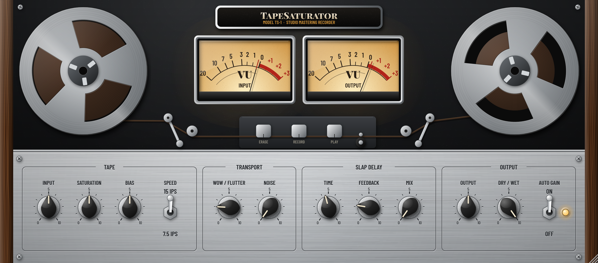

# TapeSaturator
https://notpumbaa.de/plugins/tapesaturator

A standalone tape machine emulation as **VST3 / AU / Standalone** (JUCE 8, CMake).
Made for buses and the master: tape saturation with real magnetic hysteresis, head bump,
wow & flutter, tape hiss and slap delay, all inside the look of a classic studio tape machine.
The UI has animated reels whose tape pack moves from one reel to the other, springy tension arms,
backlit VU meters behind glass, chicken-head knobs, toggle switches, brushed aluminium and walnut side panels.



**Window size:** drag the bottom-right corner (60–200 %). The size is saved with your project.

## Signal flow

```
Input ─► Record EQ ─► [4x oversampling: hysteresis (Jiles-Atherton)] ─► Playback EQ
      ─► Speed EQ (head bump, HF roll-off, bias tilt) ─► Wow & Flutter ─► Slap delay
      ─► Tape hiss ─► Output / Auto Gain ─► Dry/Wet (latency-compensated)
```

## What the plugin does

TapeSaturator simulates what happens to a signal when it is recorded to a studio tape machine
and played back:

1. **Tape saturation:** The core of the plugin. The hotter the signal hits the tape, the more it gets
   gently compressed and thickened, and warm harmonics appear. Peaks are rounded off instead of hard-clipped.
2. **Tape speed EQ:** A slight low-end lift ("head bump"), a small dip above it and a gentle high-frequency roll-off.
3. **Wow & flutter:** Small speed fluctuations of the tape (subtle pitch movement).
4. **Tape hiss:** Quiet background noise, optional.
5. **Slap delay:** Tape echo in the style of the '50s and '60s.
6. **Output and Dry/Wet:** Output level and parallel blend with the original signal.

## Controls

### TAPE
| Control | Range | What it does | Tip |
|---|---|---|---|
| **INPUT** | ±18 dB | How hard the signal hits the tape. **The most important control for saturation.** | More input = more colour and compression. |
| **SATURATION** | 0–100 % | How early the tape starts to saturate. | 30–50 % subtle, 70–100 % obvious. |
| **BIAS** | 0–100 % | Below 50 %: brighter, grittier, more distortion. Above 50 %: darker, softer, cleaner. | Start at 50 %. |
| **SPEED** | 7.5 / 15 ips | **15 ips:** more open and precise, low-end lift around 90 Hz. **7.5 ips:** warmer, low-end lift around 50 Hz, highs rolled off from about 13 kHz, slightly more hiss. | Master: usually 15 ips. Vintage character: 7.5 ips. |

### TRANSPORT
| Control | Range | What it does | Tip |
|---|---|---|---|
| **WOW/FLUTTER** | 0–100 % | Pitch fluctuation (up to 0.25 % wow, 0.08 % flutter). | **0–10 % on the master**, otherwise bass and vocals start to waver. The default (20 %) is a bit much for the master. |
| **NOISE** | off … -50 dBFS | Tape hiss. | Usually off on the master. |

### SLAP DELAY
| Control | Range | What it does | Tip |
|---|---|---|---|
| **TIME** | 30–800 ms | Echo time. Turning it bends the pitch briefly, like real tape. | Classic slapback: 80–140 ms. |
| **FEEDBACK** | 0–90 % | Number of repeats; each one gets darker. | 0–30 % for slapback, more for dub echoes. |
| **MIX** | 0–100 % | Echo level; 0 % = delay off. | **Always 0 % on the master.** |

### OUTPUT
| Control | Range | What it does | Tip |
|---|---|---|---|
| **OUTPUT** | ±18 dB | Output level. | Use it to level-match for a fair A/B comparison. |
| **DRY/WET** | 0–100 % | Blend with the unprocessed signal (latency-compensated). | 50–80 % = parallel saturation, transients stay intact. |
| **AUTO GAIN** | on/off | Automatically compensates the INPUT control at the output. | **Leave it on**, so you hear the actual change in tone rather than just "louder". |

**Handling:** drag a knob to change its value, **double-click to reset it to the default**. The exact value
shows up while dragging or hovering.

## The VU meters

- **0 VU equals -18 dBFS** (average level, not peak level).
- The needle is intentionally slow, like a real VU meter, and shows perceived loudness.
- **Input around 0 VU:** clean operating point with a touch of colour.
- **Input in the red (+1 to +3):** clearly audible saturation and compression.

## How to set it up

1. **Start neutral:** Wow/Flutter 0 %, Noise 0 %, Delay Mix 0 %, Auto Gain on.
2. **Set the input level:** Adjust INPUT so the left VU meter hovers around **0 VU** during loud passages.
3. **Dial in the colour:** Raise SATURATION slowly until things audibly "glue" together, then back off a little.
4. **Choose the character:** Set SPEED and BIAS to taste: warmer (7.5 ips, higher bias) or more open (15 ips, bias 50 %).
5. **Compare fairly:** Toggle your DAW's bypass and, if needed, use OUTPUT to match loudness.
   Louder always sounds "better" and fools your ears.
6. **Too much saturation?** Pull DRY/WET down a bit rather than removing the saturation completely.

## Starting points

| Use case | Input | Saturation | Bias | Speed | Wow/Flutter | Noise | Delay Mix | Dry/Wet |
|---|---|---|---|---|---|---|---|---|
| **Master (subtle)** | 0 dB | 30 % | 50 % | 15 ips | 0–5 % | 0 % | 0 % | 100 % |
| **Mix bus / group** | +3 dB | 50 % | 50 % | 15 ips | 5 % | 0 % | 0 % | 100 % |
| **Drums (punch)** | +6 dB | 70 % | 40 % | 15 ips | 0 % | 0 % | 0 % | 60 % |
| **Bass (warmth)** | +3 dB | 60 % | 60 % | 7.5 ips | 0 % | 0 % | 0 % | 100 % |
| **Vocals (slapback)** | +2 dB | 40 % | 50 % | 15 ips | 10 % | 0 % | 25–40 % (Time 110 ms, Feedback 15 %) | 100 % |
| **Lo-fi / vintage** | +9 dB | 90 % | 30 % | 7.5 ips | 50–70 % | 40–60 % | to taste | 100 % |

These are starting points; adjust by ear.

### On the master

- **After EQ, before the limiter:** TapeSaturator belongs **before** your final limiter.
- **Less is more:** 1–2 dB of tape "compression" is often enough. The effect should be felt more than heard.
- **Latency:** about 78 samples at 48 kHz (~1.6 ms). The plugin reports it to the DAW, which compensates automatically.

## Downloads

Release builds: **[Releases](https://github.com/notpumbaa/TapeSaturator/releases)** (ZIPs are attached automatically when a release is published).

Every push is also built by **GitHub Actions** (*Actions* tab → latest run → *Artifacts*):

- `TapeSaturator-macOS`: AU, VST3, Standalone (Universal: Apple Silicon + Intel)
- `TapeSaturator-Windows`: VST3, Standalone

Every ZIP contains the plugin together with `LICENSE.txt`, a short `README.txt` (installation and a link to
the exact source code of that build), `THIRD-PARTY-NOTICES.txt` and the folder `third-party-licenses/`.

### Installing on macOS

1. Unzip the files.
2. `TapeSaturator.component` → `~/Library/Audio/Plug-Ins/Components/`
   `TapeSaturator.vst3` → `~/Library/Audio/Plug-Ins/VST3/`
3. The builds are not notarized, so remove the quarantine flag once in Terminal:
   ```bash
   xattr -dr com.apple.quarantine ~/Library/Audio/Plug-Ins/Components/TapeSaturator.component ~/Library/Audio/Plug-Ins/VST3/TapeSaturator.vst3
   ```
4. Restart your DAW (Logic: if needed, Plug-in Manager → *Reset & Rescan*).

### Installing on Windows

Copy `TapeSaturator.vst3` to `C:\Program Files\Common Files\VST3\` and let your DAW rescan.

## Building from source

Requirements: CMake ≥ 3.22 and a C++20 compiler (Xcode / Visual Studio 2022 / GCC / Clang).
JUCE is downloaded automatically.

```bash
cmake -B build -DCMAKE_BUILD_TYPE=Release
cmake --build build --config Release --parallel
ctest --test-dir build -C Release --output-on-failure
```

The option `-DTAPESAT_COPY_AFTER_BUILD=ON` copies the plugins into the system plugin folders after building.

### Tests and audio examples

`TapeSaturatorTests` checks level stability, distortion behaviour (saturation/bias), stability in the worst case,
latency-compensated dry/wet and state save/restore. It can also:

```bash
./build/TapeSaturatorTests_artefacts/Release/TapeSaturatorTests --render render   # render WAV examples
./build/TapeSaturatorTests_artefacts/Release/TapeSaturatorTests --snapshot ui.png  # screenshot of the UI
```

## Project structure

```
Source/
  PluginProcessor.*     plugin wrapper, parameters → DSP
  PluginEditor.*        editor window, scaling
  Parameters.*          parameter definitions (IDs, ranges)
  dsp/Hysteresis.h      Jiles-Atherton tape model (RK4)
  dsp/TapeEngine.*      complete signal chain
  ui/TapeLookAndFeel.*  look (chicken-head knobs, toggle switches, brushed metal, wood)
  ui/VUMeter.*          analogue VU meter with ballistics
  ui/TapeReel.h         tape reel with tape pack
  ui/TapeMachine.*      complete UI + transport mechanics (spin-up, tension arms)
  ui/Fonts.*            embedded fonts
tests/TestMain.cpp      DSP tests, offline renderer, UI snapshot
packaging/              license/readme files bundled into every download ZIP
.github/workflows/      CI for macOS + Windows incl. auval / pluginval
```

## License

Copyright (C) 2026 notpumbaa

TapeSaturator is free software, licensed under the **GNU Affero General Public License v3.0** (AGPL-3.0).
See [`LICENSE`](LICENSE) for the full text.

In short: you may use, study, modify and share it. If you distribute it, or a modified version of it,
you must make the complete source code available under the same license.

Third-party components:

- **JUCE** (https://juce.com) is used under its AGPLv3 option.
- **Fonts:** *Barlow Condensed* and *Playfair Display SC*, both under the SIL Open Font License 1.1
  (see `Resources/fonts/OFL-*.txt`).

VST is a registered trademark of Steinberg Media Technologies GmbH. Audio Units is a trademark of Apple Inc.
TapeSaturator is an independent project and is not affiliated with or endorsed by any tape machine or plugin manufacturer.

## Security

Please report security issues privately, see [`SECURITY.md`](SECURITY.md).
